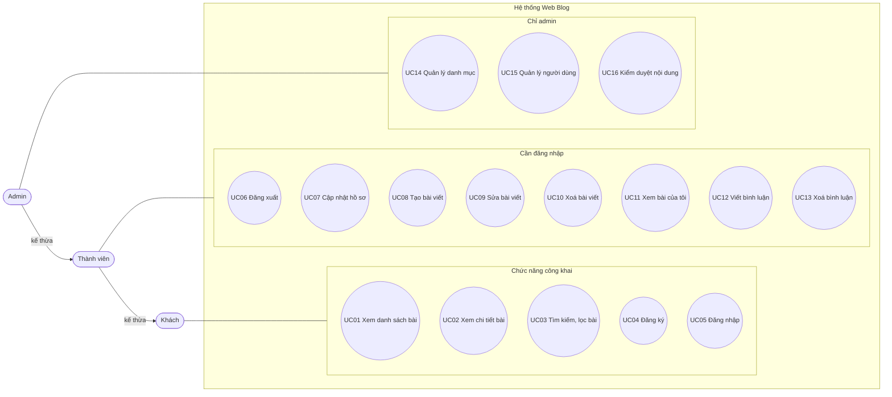
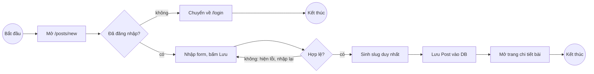
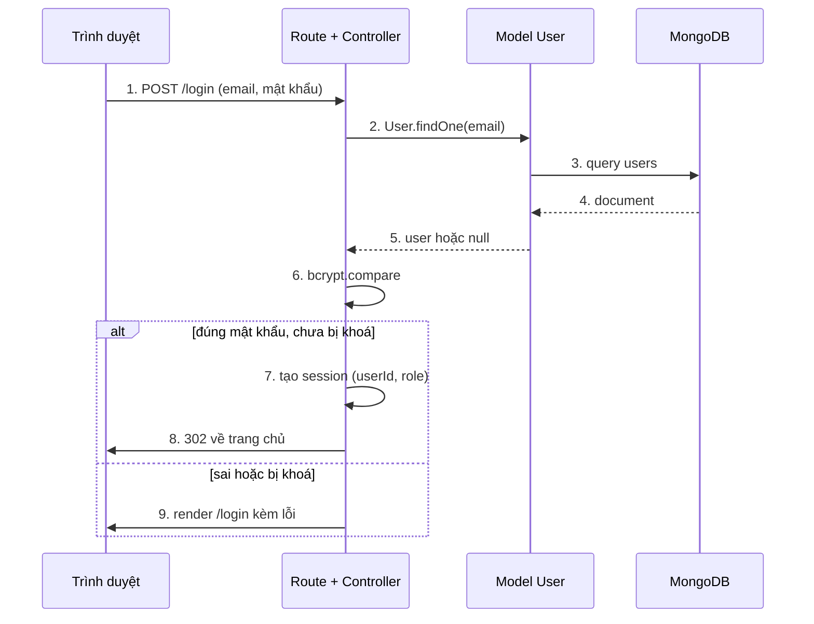

# 02 · Actor và use case

> Trạng thái: **ĐÃ CHỐT** (2026-10-29). Đây là contract. Muốn đổi phải được nhóm duyệt.

## Actor

Có 3 actor theo quan hệ kế thừa: Thành viên làm được mọi thứ của Khách, Admin làm được mọi thứ của Thành viên.

| Actor | Mô tả |
| --- | --- |
| Khách (Guest) | Người chưa đăng nhập. Chỉ xem và tìm bài, đăng ký, đăng nhập. |
| Thành viên (Member) | Người đã đăng nhập. Viết bài, bình luận, quản lý nội dung của chính mình. |
| Admin | Quản trị viên. Quản lý người dùng, danh mục, xoá bất kỳ bài/bình luận nào. |

## Danh sách use case

| Mã | Use case | Actor chính | Quy tắc liên quan |
| --- | --- | --- | --- |
| UC01 | Xem danh sách bài viết (phân trang) | Khách | BR5, BR7 |
| UC02 | Xem chi tiết bài viết + bình luận | Khách | BR5 |
| UC03 | Tìm kiếm / lọc theo danh mục, tag | Khách | |
| UC04 | Đăng ký | Khách | BR3 |
| UC05 | Đăng nhập | Khách | BR8 |
| UC06 | Đăng xuất | Thành viên | |
| UC07 | Cập nhật hồ sơ / đổi mật khẩu | Thành viên | BR3 |
| UC08 | Tạo bài viết | Thành viên | BR1, BR4 |
| UC09 | Sửa bài viết | Thành viên | BR2 |
| UC10 | Xoá bài viết | Thành viên | BR2, BR6 |
| UC11 | Xem danh sách bài của tôi (kể cả nháp) | Thành viên | BR5 |
| UC12 | Viết bình luận | Thành viên | BR1 |
| UC13 | Xoá bình luận | Thành viên | BR2 |
| UC14 | Quản lý danh mục (thêm/sửa/xoá) | Admin | |
| UC15 | Quản lý người dùng (xem, khoá/mở, đổi vai trò) | Admin | BR8 |
| UC16 | Kiểm duyệt nội dung (xoá bài/bình luận bất kỳ) | Admin | BR2, BR6 |

UC08, UC09, UC10, UC12, UC13 đều **include** "Kiểm tra đăng nhập". UC09, UC10, UC13 còn include "Kiểm tra quyền sở hữu".

## Sơ đồ use case

## Đặc tả use case chính

### UC05 · Đăng nhập

| Mục | Nội dung |
| --- | --- |
| Actor | Khách |
| Tiền điều kiện | Đã có tài khoản, chưa đăng nhập |
| Luồng chính | 1. Mở trang `/login`. 2. Nhập email + mật khẩu. 3. Hệ thống tìm user theo email. 4. So sánh mật khẩu với hash (bcrypt). 5. Tạo session, chuyển về trang chủ. |
| Luồng phụ | 3a. Không tìm thấy email hoặc 4a. sai mật khẩu: báo "Sai email hoặc mật khẩu". 3b. Tài khoản bị khoá: báo lỗi (BR8). |
| Hậu điều kiện | Session chứa `userId` và `role` |

### UC08 · Tạo bài viết

| Mục | Nội dung |
| --- | --- |
| Actor | Thành viên |
| Tiền điều kiện | Đã đăng nhập (BR1) |
| Luồng chính | 1. Mở `/posts/new`. 2. Nhập tiêu đề, nội dung, chọn danh mục, tag, trạng thái. 3. Bấm Lưu. 4. Hệ thống kiểm tra dữ liệu. 5. Sinh slug từ tiêu đề (BR4). 6. Lưu bài với `author` = user hiện tại. 7. Chuyển tới trang chi tiết bài. |
| Luồng phụ | 4a. Thiếu tiêu đề/nội dung: hiện lại form kèm lỗi. 5a. Slug trùng: thêm hậu tố `-2`, `-3`. Chưa đăng nhập: chuyển về `/login`. |
| Hậu điều kiện | Bài mới nằm trong DB; nếu `published` thì hiện ở trang chủ |

### UC12 · Viết bình luận

| Mục | Nội dung |
| --- | --- |
| Actor | Thành viên |
| Tiền điều kiện | Đã đăng nhập, bài viết đã đăng |
| Luồng chính | 1. Ở trang chi tiết bài, nhập nội dung. 2. Bấm Gửi. 3. Lưu comment với `post` và `author`. 4. Tải lại trang, comment hiện cuối danh sách. |
| Luồng phụ | 2a. Nội dung rỗng hoặc quá 1000 ký tự: báo lỗi. Chưa đăng nhập: ẩn form, hiện link đăng nhập. |
| Hậu điều kiện | Comment mới gắn với bài |

## Sơ đồ hoạt động · UC08 Tạo bài viết

## Sơ đồ tuần tự · UC05 Đăng nhập

