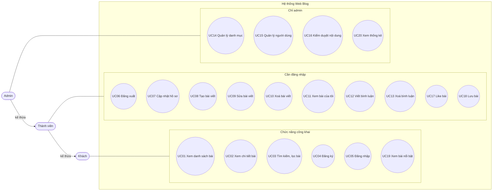
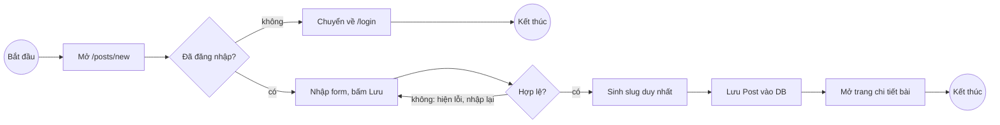
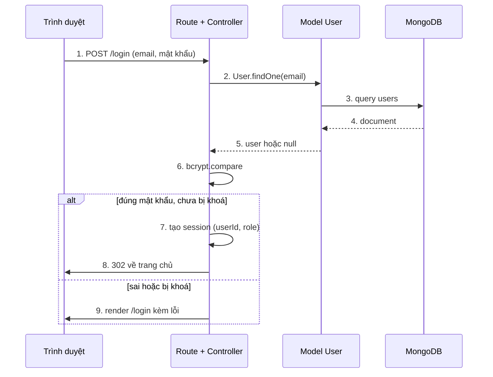

# 02 · Actor và use case

> Trạng thái: **ĐÃ CHỐT** (2026-10-29). Đây là contract. Muốn đổi phải được nhóm duyệt.

## Actor

Có 3 actor theo quan hệ kế thừa: Thành viên làm được mọi thứ của Khách, Admin làm được mọi thứ của Thành viên.

| Actor | Mô tả |
| --- | --- |
| Khách (Guest) | Người chưa đăng nhập. Chỉ xem và tìm bài, đăng ký, đăng nhập. |
| Thành viên (Member) | Người đã đăng nhập. Viết bài, bình luận, like, lưu bài, quản lý nội dung của chính mình. |
| Admin | Quản trị viên. Quản lý người dùng, danh mục, xoá bất kỳ bài/bình luận nào, xem thống kê. |

## Danh sách use case

| Mã | Use case | Actor chính | Quy tắc liên quan |
| --- | --- | --- | --- |
| UC01 | Xem danh sách bài viết (phân trang) | Khách | BR5, BR7 |
| UC02 | Xem chi tiết bài viết + bình luận (tăng lượt xem) | Khách | BR5, BR10 |
| UC03 | Tìm kiếm full-text, lọc kết hợp danh mục + tag | Khách | BR5 |
| UC04 | Đăng ký | Khách | BR3 |
| UC05 | Đăng nhập | Khách | BR8 |
| UC06 | Đăng xuất | Thành viên | |
| UC07 | Cập nhật hồ sơ / đổi mật khẩu | Thành viên | BR3 |
| UC08 | Tạo bài viết (có thể kèm ảnh bìa) | Thành viên | BR1, BR4, BR11 |
| UC09 | Sửa bài viết (đổi / xoá ảnh bìa) | Thành viên | BR2, BR11 |
| UC10 | Xoá bài viết | Thành viên | BR2, BR6 |
| UC11 | Xem danh sách bài của tôi (kể cả nháp) | Thành viên | BR5 |
| UC12 | Viết bình luận | Thành viên | BR1 |
| UC13 | Xoá bình luận | Thành viên | BR2 |
| UC14 | Quản lý danh mục (thêm/sửa/xoá) | Admin | |
| UC15 | Quản lý người dùng (xem, khoá/mở, đổi vai trò) | Admin | BR8 |
| UC16 | Kiểm duyệt nội dung (xoá bài/bình luận bất kỳ) | Admin | BR2, BR6 |
| UC17 | Like / bỏ like bài viết | Thành viên | BR1, BR9 |
| UC18 | Lưu / bỏ lưu bài viết, xem danh sách đã lưu | Thành viên | BR1, BR5, BR9 |
| UC19 | Xem bài nổi bật (nhiều lượt xem nhất) | Khách | BR5 |
| UC20 | Xem trang thống kê | Admin | |

UC08, UC09, UC10, UC12, UC13, UC17, UC18 đều **include** "Kiểm tra đăng nhập". UC09, UC10, UC13 còn include "Kiểm tra quyền sở hữu".

## Sơ đồ use case

## Đặc tả use case chính

### UC05 · Đăng nhập

| Mục | Nội dung |
| --- | --- |
| Actor | Khách |
| Tiền điều kiện | Đã có tài khoản, chưa đăng nhập |
| Luồng chính | 1. Mở trang `/login`. 2. Nhập email + mật khẩu. 3. Hệ thống tìm user theo email. 4. So sánh mật khẩu với hash (bcrypt). 5. Tạo session, chuyển về trang chủ. |
| Luồng phụ | 3a. Không tìm thấy email hoặc 4a. sai mật khẩu: báo "Sai email hoặc mật khẩu". 3b. Tài khoản bị khoá: báo lỗi (BR8). |
| Hậu điều kiện | Session chứa `userId` và `role` |

### UC08 · Tạo bài viết

| Mục | Nội dung |
| --- | --- |
| Actor | Thành viên |
| Tiền điều kiện | Đã đăng nhập (BR1) |
| Luồng chính | 1. Mở `/posts/new`. 2. Nhập tiêu đề, nội dung, chọn danh mục, tag, trạng thái, ảnh bìa (không bắt buộc). 3. Bấm Lưu. 4. Hệ thống kiểm tra dữ liệu. 5. Sinh slug từ tiêu đề (BR4). 6. Lưu bài với `author` = user hiện tại. 7. Chuyển tới trang chi tiết bài. |
| Luồng phụ | 4a. Thiếu tiêu đề/nội dung: hiện lại form kèm lỗi. 4b. Ảnh bìa sai định dạng hoặc quá 2 MB: hiện lại form kèm lỗi, không lưu file (BR11). 5a. Slug trùng: thêm hậu tố `-2`, `-3`. Chưa đăng nhập: chuyển về `/login`. |
| Hậu điều kiện | Bài mới nằm trong DB; nếu `published` thì hiện ở trang chủ |

### UC12 · Viết bình luận

| Mục | Nội dung |
| --- | --- |
| Actor | Thành viên |
| Tiền điều kiện | Đã đăng nhập, bài viết đã đăng |
| Luồng chính | 1. Ở trang chi tiết bài, nhập nội dung. 2. Bấm Gửi. 3. Lưu comment với `post` và `author`. 4. Tải lại trang, comment hiện cuối danh sách. |
| Luồng phụ | 2a. Nội dung rỗng hoặc quá 1000 ký tự: báo lỗi. Chưa đăng nhập: ẩn form, hiện link đăng nhập. |
| Hậu điều kiện | Comment mới gắn với bài |

### UC03 · Tìm kiếm, lọc bài

| Mục | Nội dung |
| --- | --- |
| Actor | Khách |
| Tiền điều kiện | Không |
| Luồng chính | 1. Nhập từ khoá ở ô tìm kiếm, chọn danh mục, nhập tag (đều không bắt buộc). 2. Gửi `GET /search?q=&category=&tag=`. 3. Hệ thống lọc bài `published`, khớp đủ mọi điều kiện đã nhập: từ khoá dùng text index trên `title` (`$text`), danh mục theo slug, tag được trim + lowercase rồi so khớp đúng với một phần tử của `tags`. 4. Có từ khoá thì sắp theo độ khớp, không có thì mới nhất trước. 5. Hiện kết quả 10 bài/trang, giữ nguyên điều kiện khi chuyển trang. |
| Luồng phụ | 2a. Không nhập điều kiện nào: chuyển về `/`. 3a. Không có kết quả: báo "Không tìm thấy bài viết phù hợp". 3b. Danh mục không tồn tại: coi như không có kết quả. |
| Hậu điều kiện | Không đổi dữ liệu |

### UC17 · Like / bỏ like bài viết

| Mục | Nội dung |
| --- | --- |
| Actor | Thành viên |
| Tiền điều kiện | Đã đăng nhập (BR1), bài đã đăng |
| Luồng chính | 1. Ở trang chi tiết bài, bấm nút Like (form POST). 2. Hệ thống tìm Like có `user` + `post`. 3. Chưa có thì tạo, đã có thì xoá (BR9). 4. Quay lại trang bài, nút đổi trạng thái, số like cập nhật. |
| Luồng phụ | Bài nháp hoặc không tồn tại: 404. Chưa đăng nhập: chuyển về `/login`. Bấm 2 lần cùng lúc: unique index chặn bản ghi trùng. |
| Hậu điều kiện | Mỗi cặp (user, bài) có tối đa 1 Like |

UC18 (lưu bài) giống hệt UC17 với collection Bookmark, thêm trang `/me/bookmarks` liệt kê bài đã lưu còn ở trạng thái `published`, mới lưu nhất trước.

### UC20 · Xem trang thống kê

| Mục | Nội dung |
| --- | --- |
| Actor | Admin |
| Tiền điều kiện | Đã đăng nhập, `role = admin` |
| Luồng chính | 1. Mở `/admin`. 2. Hệ thống chạy các truy vấn đếm và aggregation pipeline (danh sách ở specs/03, mục "Truy vấn thống kê"). 3. Hiện các con số tổng và các bảng thống kê. |
| Luồng phụ | Không phải admin: 403. Chưa có dữ liệu: bảng hiện "Chưa có dữ liệu". |
| Hậu điều kiện | Không đổi dữ liệu |

## Sơ đồ hoạt động · UC08 Tạo bài viết

## Sơ đồ tuần tự · UC05 Đăng nhập

