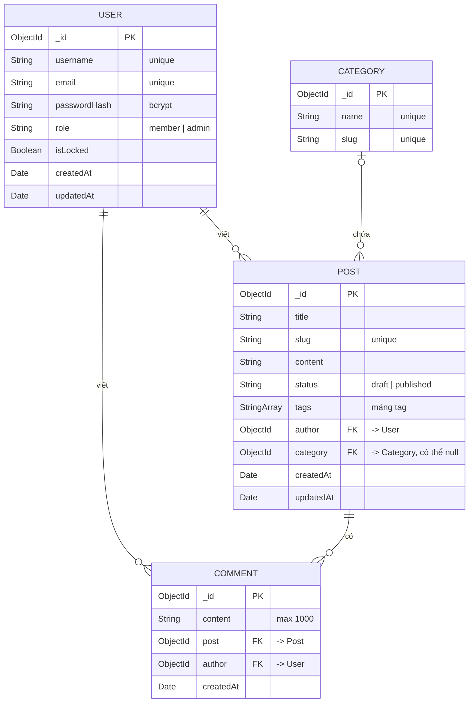

# 03 · Mô hình dữ liệu (ERD + schema)

> Trạng thái: **ĐÃ CHỐT** (2026-10-29). Đây là contract. Muốn đổi phải được nhóm duyệt.

## ERD



PK là khoá chính, FK là trường ObjectId tham chiếu sang collection khác (Mongoose `ref` + `populate`).

| Quan hệ | Kiểu | Cách lưu trong MongoDB |
| --- | --- | --- |
| User – Post | 1 – n | `Post.author` tham chiếu User |
| User – Comment | 1 – n | `Comment.author` tham chiếu User |
| Post – Comment | 1 – n | `Comment.post` tham chiếu Post, collection riêng |
| Category – Post | 1 – n | `Post.category` tham chiếu Category (có thể null) |

**Vì sao Comment là collection riêng?** Số bình luận không giới hạn, nhúng vào sẽ làm document Post phình to (giới hạn 16 MB). Xoá hoặc phân trang bình luận cũng dễ hơn. Ngược lại, `tags` là mảng nhỏ nên nhúng luôn vào Post.

## Schema chi tiết

Cả 4 schema đều bật `timestamps: true`, Mongoose tự thêm `createdAt` và `updatedAt`. Collection `sessions` do connect-mongo tự tạo, không cần thiết kế.

### User

| Trường | Kiểu | Bắt buộc | Mặc định | Ràng buộc / validate |
| --- | --- | --- | --- | --- |
| username | String | Có | | unique, trim, 3–30 ký tự, chỉ chữ, số và `_` |
| email | String | Có | | unique, lowercase, trim, đúng định dạng email |
| passwordHash | String | Có | | hash bcrypt (10 salt rounds), `select: false` để không lộ ra khi query |
| role | String | Có | `member` | enum: `member`, `admin` |
| isLocked | Boolean | | `false` | `true` thì không đăng nhập được (BR8) |

### Post

| Trường | Kiểu | Bắt buộc | Mặc định | Ràng buộc / validate |
| --- | --- | --- | --- | --- |
| title | String | Có | | trim, 5–200 ký tự |
| slug | String | Có | tự sinh | unique, lowercase; sinh từ title, bỏ dấu tiếng Việt; người dùng không nhập |
| content | String | Có | | tối thiểu 20 ký tự |
| status | String | Có | `draft` | enum: `draft`, `published` |
| tags | [String] | | `[]` | mỗi tag lowercase, trim; tối đa 10 tag |
| author | ObjectId → User | Có | | gán từ session, không lấy từ form |
| category | ObjectId → Category | | `null` | `null` = "Chưa phân loại" |

### Category

| Trường | Kiểu | Bắt buộc | Mặc định | Ràng buộc / validate |
| --- | --- | --- | --- | --- |
| name | String | Có | | unique, trim, tối đa 50 ký tự |
| slug | String | Có | tự sinh | unique, lowercase, sinh từ name |

### Comment

| Trường | Kiểu | Bắt buộc | Mặc định | Ràng buộc / validate |
| --- | --- | --- | --- | --- |
| content | String | Có | | trim, 1–1000 ký tự |
| post | ObjectId → Post | Có | | bài phải tồn tại và đã `published` |
| author | ObjectId → User | Có | | gán từ session |

## Index

| Collection | Index | Mục đích |
| --- | --- | --- |
| users | `email` (unique), `username` (unique) | Đăng nhập, chặn trùng (BR3) |
| posts | `slug` (unique) | Mở bài theo URL (BR4) |
| posts | `{ status: 1, createdAt: -1 }` | Trang chủ: bài đã đăng, mới nhất trước (BR7) |
| posts | `author`, `category`, `tags` | "Bài của tôi", lọc danh mục, lọc tag |
| posts | text index trên `title` | Tìm kiếm theo từ khoá (UC03) |
| categories | `slug` (unique) | Lọc theo URL `/categories/:slug` |
| comments | `{ post: 1, createdAt: 1 }` | Lấy bình luận của bài theo thứ tự |

## Logic gắn với schema

| Khi nào | Xử lý | Đặt ở đâu |
| --- | --- | --- |
| Đăng ký / đổi mật khẩu | Hash mật khẩu rồi lưu vào `passwordHash` | Method `user.setPassword()` |
| Đăng nhập | So khớp mật khẩu với hash | Method `user.comparePassword()` |
| Lưu Post / Category | Title (name) đổi thì sinh lại slug, trùng thì thêm `-2`, `-3` | Hook `pre('validate')` |
| Xoá Post | Xoá hết Comment có `post` = bài đó (BR6) | Controller |
| Xoá Category | Đặt `category = null` cho các bài thuộc danh mục | Controller |
| Admin "xoá" User | Không xoá thật, chỉ đặt `isLocked = true` để bài/bình luận cũ không mất tác giả | Controller |

## Ví dụ một document Post

```json
{
  "_id": "6720a1f0c3b2a1d4e5f60789",
  "title": "Học Node.js từ đầu",
  "slug": "hoc-nodejs-tu-dau",
  "content": "Node.js là môi trường chạy JavaScript phía server...",
  "status": "published",
  "tags": ["nodejs", "backend"],
  "author": "6720a0e1c3b2a1d4e5f60001",
  "category": "6720a0f2c3b2a1d4e5f60010",
  "createdAt": "2026-10-29T02:30:00Z",
  "updatedAt": "2026-10-29T02:30:00Z"
}
```
