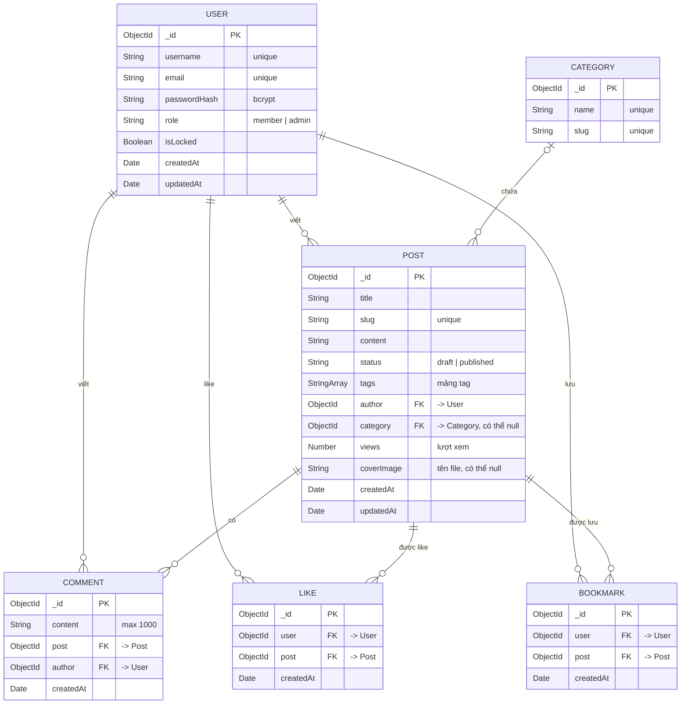

# 03 · Mô hình dữ liệu (ERD + schema)

> Trạng thái: **ĐÃ CHỐT** (2026-10-29). Đây là contract. Muốn đổi phải được nhóm duyệt.

## ERD



PK là khoá chính, FK là trường ObjectId tham chiếu sang collection khác (Mongoose `ref` + `populate`).

| Quan hệ | Kiểu | Cách lưu trong MongoDB |
| --- | --- | --- |
| User – Post | 1 – n | `Post.author` tham chiếu User |
| User – Comment | 1 – n | `Comment.author` tham chiếu User |
| Post – Comment | 1 – n | `Comment.post` tham chiếu Post, collection riêng |
| Category – Post | 1 – n | `Post.category` tham chiếu Category (có thể null) |
| User – Post (like) | n – n | Collection trung gian `likes` { user, post }, unique theo cặp |
| User – Post (lưu) | n – n | Collection trung gian `bookmarks` { user, post }, unique theo cặp |

**Vì sao Comment là collection riêng?** Số bình luận không giới hạn, nhúng vào sẽ làm document Post phình to (giới hạn 16 MB). Xoá hoặc phân trang bình luận cũng dễ hơn. Ngược lại, `tags` là mảng nhỏ nên nhúng luôn vào Post.

**Vì sao like / bookmark là collection trung gian, không nhúng mảng `likedBy` vào Post?** Số like không giới hạn (cùng lý do với Comment). Collection trung gian với unique index `{ user, post }` cho phép DB tự chặn like trùng (BR9), lấy "bài tôi đã lưu" bằng index `user`, và đếm / xếp hạng bằng aggregation. Đây là cách biểu diễn quan hệ n – n chuẩn trong MongoDB khi một phía có thể rất lớn.

## Schema chi tiết

User, Post, Category, Comment bật `timestamps: true`, Mongoose tự thêm `createdAt` và `updatedAt`. Like, Bookmark không bao giờ bị sửa nên chỉ bật `timestamps: { createdAt: true, updatedAt: false }`. Collection `sessions` do connect-mongo tự tạo, không cần thiết kế.

### User

| Trường | Kiểu | Bắt buộc | Mặc định | Ràng buộc / validate |
| --- | --- | --- | --- | --- |
| username | String | Có | | unique, lowercase, trim, 3–30 ký tự, chỉ chữ, số và `_` |
| email | String | Có | | unique, lowercase, trim, đúng định dạng email |
| passwordHash | String | Có | | hash bcrypt (10 salt rounds), `select: false` để không lộ ra khi query |
| role | String | Có | `member` | enum: `member`, `admin` |
| isLocked | Boolean | | `false` | `true` thì không đăng nhập được (BR8) |

### Post

| Trường | Kiểu | Bắt buộc | Mặc định | Ràng buộc / validate |
| --- | --- | --- | --- | --- |
| title | String | Có | | trim, 5–200 ký tự |
| slug | String | Có | tự sinh | unique, lowercase; sinh từ title, bỏ dấu tiếng Việt; người dùng không nhập |
| content | String | Có | | tối thiểu 20 ký tự |
| status | String | Có | `draft` | enum: `draft`, `published` |
| tags | [String] | | `[]` | mỗi tag lowercase, trim; tối đa 10 tag |
| author | ObjectId → User | Có | | gán từ session, không lấy từ form |
| category | ObjectId → Category | | `null` | `null` = "Chưa phân loại" |
| views | Number | | `0` | min 0; chỉ tăng bằng `$inc` (BR10), không lấy từ form |
| coverImage | String | | `null` | tên file trong `uploads/` (do server đặt), không lấy từ form; `null` = không có ảnh bìa |

### Category

| Trường | Kiểu | Bắt buộc | Mặc định | Ràng buộc / validate |
| --- | --- | --- | --- | --- |
| name | String | Có | | unique, trim, tối đa 50 ký tự |
| slug | String | Có | tự sinh | unique, lowercase, sinh từ name |

### Comment

| Trường | Kiểu | Bắt buộc | Mặc định | Ràng buộc / validate |
| --- | --- | --- | --- | --- |
| content | String | Có | | trim, 1–1000 ký tự |
| post | ObjectId → Post | Có | | bài phải tồn tại và đã `published` |
| author | ObjectId → User | Có | | gán từ session |

### Like, Bookmark

Hai collection cùng cấu trúc (`likes`, `bookmarks`), mỗi document là một cặp "user đã like / đã lưu bài".

| Trường | Kiểu | Bắt buộc | Mặc định | Ràng buộc / validate |
| --- | --- | --- | --- | --- |
| user | ObjectId → User | Có | | gán từ session |
| post | ObjectId → Post | Có | | bài phải tồn tại và đã `published` |

## Index

| Collection | Index | Mục đích |
| --- | --- | --- |
| users | `email` (unique), `username` (unique) | Đăng nhập, chặn trùng (BR3) |
| posts | `slug` (unique) | Mở bài theo URL (BR4) |
| posts | `{ status: 1, createdAt: -1 }` | Trang chủ: bài đã đăng, mới nhất trước (BR7) |
| posts | `author`, `category`, `tags` | "Bài của tôi", lọc danh mục, lọc tag |
| posts | text index trên `title`, `default_language: 'none'` | Tìm kiếm full-text theo từ khoá (UC03). `none` để MongoDB không bỏ stop word, không cắt đuôi từ theo tiếng Anh |
| posts | `{ status: 1, views: -1 }` | Bài nổi bật (UC19) |
| categories | `slug` (unique) | Lọc theo URL `/categories/:slug` |
| comments | `{ post: 1, createdAt: 1 }` | Lấy bình luận của bài theo thứ tự |
| likes, bookmarks | `{ user: 1, post: 1 }` (unique) | Chặn like / lưu trùng (BR9), kiểm tra "tôi đã like chưa", trang "Đã lưu" |
| likes, bookmarks | `post` | Đếm like của một bài, xoá theo bài (BR6), thống kê |
| bookmarks | `{ user: 1, createdAt: -1 }` | Trang "Đã lưu": lọc theo user, mới lưu nhất trước, phân trang |

## Logic gắn với schema

| Khi nào | Xử lý | Đặt ở đâu |
| --- | --- | --- |
| Đăng ký / đổi mật khẩu | Hash mật khẩu rồi lưu vào `passwordHash` | Method `user.setPassword()` |
| Đăng nhập | So khớp mật khẩu với hash | Method `user.comparePassword()` |
| Lưu Post / Category | Title (name) đổi thì sinh lại slug, trùng thì thêm `-2`, `-3` | Hook `pre('validate')` |
| Xoá Post | Xoá hết Comment, Like, Bookmark có `post` = bài đó và file ảnh bìa (BR6) | Controller |
| Mở bài đã đăng (không phải tác giả) | `Post.updateOne({ _id }, { $inc: { views: 1 } }, { timestamps: false })` để không đổi `updatedAt` (BR10) | Controller |
| Like / lưu bài | Có cặp (user, post) thì xoá, chưa có thì tạo; lỗi 11000 (bấm 2 lần cùng lúc) coi như đã like | Controller |
| Đổi / xoá ảnh bìa | Lưu bài thành công rồi mới xoá file cũ; lưu bài lỗi thì xoá file vừa upload | Controller |
| Xoá Category | Đặt `category = null` cho các bài thuộc danh mục | Controller |
| Admin "xoá" User | Không xoá thật, chỉ đặt `isLocked = true` để bài/bình luận cũ không mất tác giả | Controller |

## Truy vấn thống kê (UC20)

Trang `/admin` chạy các truy vấn sau. Mỗi truy vấn là một aggregation pipeline hoặc một lệnh đếm, không lưu kết quả vào DB.

| Bảng / số liệu | Collection | Pipeline (rút gọn) |
| --- | --- | --- |
| Tổng số user, số bị khoá | users | `countDocuments()`, `countDocuments({ isLocked: true })` |
| Số bài theo trạng thái | posts | `$group: { _id: '$status', count: { $sum: 1 } }` |
| Tổng bình luận, tổng like | comments, likes | `countDocuments()` |
| Bài đăng theo tháng (6 tháng gần nhất) | posts | `$match` (published, `createdAt` ≥ 6 tháng trước) → `$group` theo `{ $year, $month }` của `createdAt` → `$sort` |
| Top 5 tác giả nhiều bài đã đăng | posts | `$match` (published) → `$group: { _id: '$author', count: { $sum: 1 } }` → `$sort: { count: -1 }` → `$limit: 5` → `$lookup` users lấy `username` |
| Top 5 bài nhiều like | likes | `$group: { _id: '$post', count: { $sum: 1 } }` → `$lookup` posts → `$match` bài `published` → `$sort: { count: -1 }` → `$limit: 5`, lấy `title`, `slug` |
| Top 5 bài nhiều bình luận | comments | Như trên, trên collection comments |
| Top 5 bài nhiều lượt xem | posts | `find({ status: 'published' }).sort({ views: -1 }).limit(5)` |

## Ví dụ một document Post

```json
{
  "_id": "6720a1f0c3b2a1d4e5f60789",
  "title": "Học Node.js từ đầu",
  "slug": "hoc-nodejs-tu-dau",
  "content": "Node.js là môi trường chạy JavaScript phía server...",
  "status": "published",
  "tags": ["nodejs", "backend"],
  "author": "6720a0e1c3b2a1d4e5f60001",
  "category": "6720a0f2c3b2a1d4e5f60010",
  "views": 42,
  "coverImage": "1730168000000-a1b2c3d4.jpg",
  "createdAt": "2026-10-29T02:30:00Z",
  "updatedAt": "2026-10-29T02:30:00Z"
}
```
